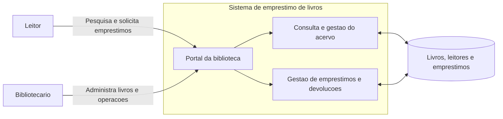
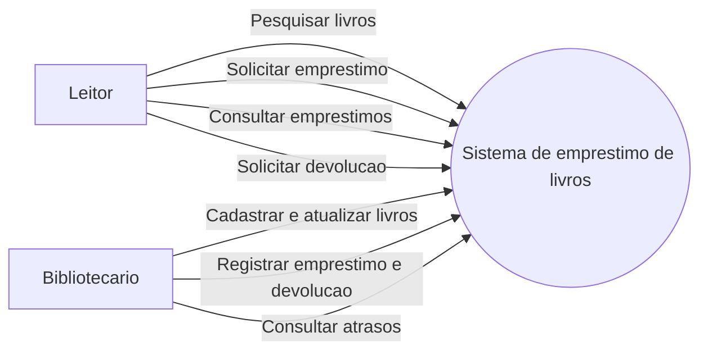
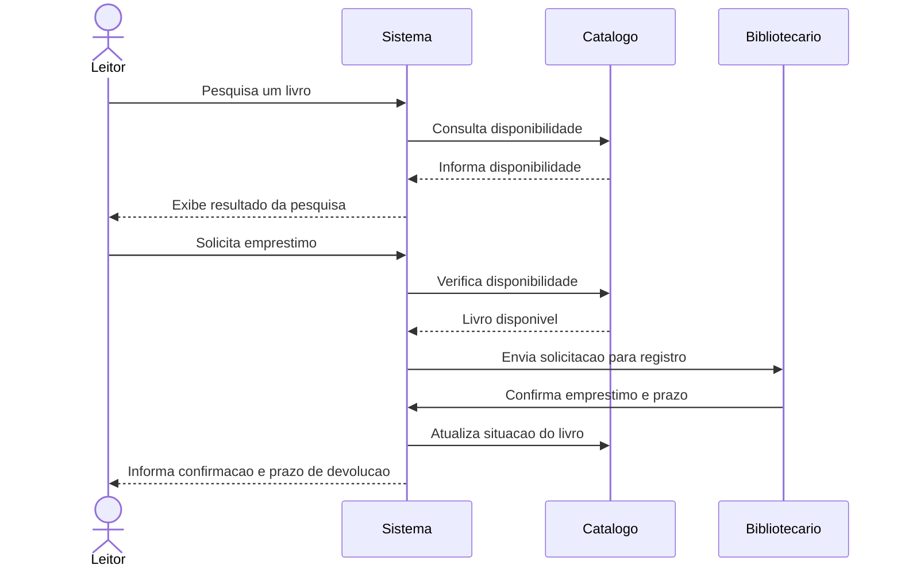
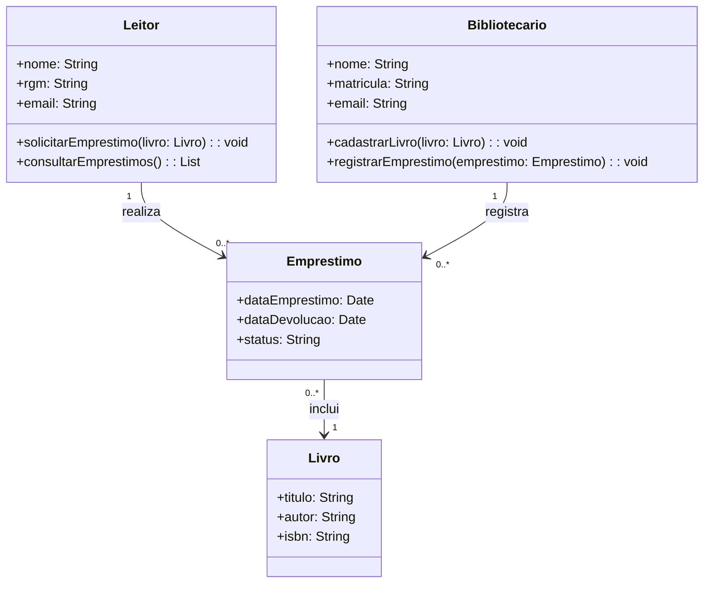
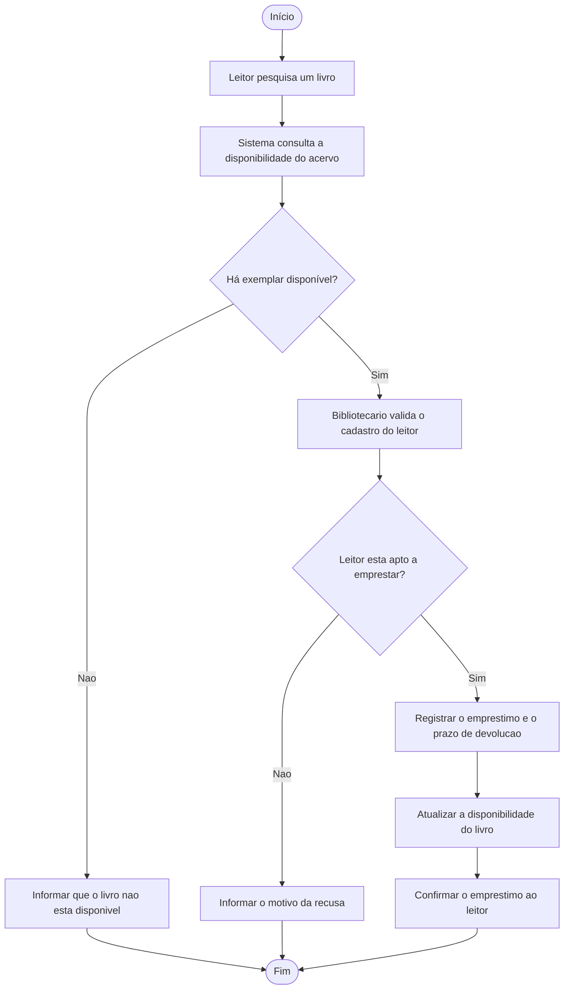

## Processo Unificado (UP)

O Processo Unificado (UP) adota o desenvolvimento de software baseado em componentes. O sistema é construído pela composição de componentes conectados por interfaces bem definidas.

O UP também utiliza desenvolvimento iterativo e incremental. Para identificar as funções do sistema, aplica uma abordagem baseada em cenários: o modelo de casos de uso.

## RUP

O Rational Unified Process (RUP) é uma instanciação mais específica do UP. Entre as práticas associadas ao processo estão:

- Desenvolvimento iterativo.
- Gerenciamento de requisitos.
- Uso de arquitetura e componentes.
- Integração contínua do trabalho da equipe.

### Anotação de aula

Na atividade sobre conflito e refatoração, foi indicado o nível de capacidade 2.

## UML

A UML (Unified Modeling Language) é uma linguagem visual usada para representar e modelar sistemas, especialmente sistemas orientados a objetos. Seus diagramas ajudam a visualizar diferentes aspectos do software.

A UML não define as fases de um processo de desenvolvimento nem determina quando cada diagrama deve ser usado. Ela fornece notações gráficas para representar o sistema.

## Exemplo: sistema de empréstimo de livros

O sistema permite que leitores pesquisem o acervo, consultem a disponibilidade e solicitem empréstimos. O bibliotecário administra os livros e registra empréstimos e devoluções. O sistema controla os prazos, atualiza a disponibilidade e permite consultar atrasos.

### Visão geral

### Diagrama de casos de uso

### Diagrama de sequência: solicitação de empréstimo

## Diagrama de componentes: loja online

Neste exemplo, a loja online é dividida em componentes com responsabilidades distintas. A interface recebe as ações do cliente e utiliza os serviços de catálogo, carrinho e pedidos. A gestão de pedidos coordena o pagamento, a atualização do estoque, o envio e as notificações. O provedor de pagamento e o serviço de entrega são sistemas externos integrados à loja.

As linhas contínuas representam as conexões entre partes internas da loja. As linhas pontilhadas destacam as integrações com os serviços externos de pagamento e entrega. O estilo da linha não indica se uma conexão é obrigatória ou opcional: isso depende das regras e dos requisitos do sistema.

**Fluxo principal:** o cliente escolhe os produtos, monta o carrinho e confirma o pedido. A loja solicita o pagamento e, após a aprovação, registra o pedido, atualiza o estoque, solicita a entrega e envia uma confirmação ao cliente.

## Diagrama de classes: sistema de empréstimo

O diagrama abaixo apresenta classes e alguns de seus atributos e métodos. As relações mostram que um leitor pode realizar empréstimos, e cada empréstimo se refere a um livro e é registrado por um bibliotecário.

## Diagrama de atividade: solicitação de empréstimo

O fluxo começa com a pesquisa do livro. Se houver exemplar disponível e o leitor estiver apto a emprestar, o bibliotecário registra a operação, o sistema atualiza o acervo e informa o prazo de devolução. Caso contrário, o leitor recebe uma mensagem explicando que o empréstimo não pode ser concluído.

