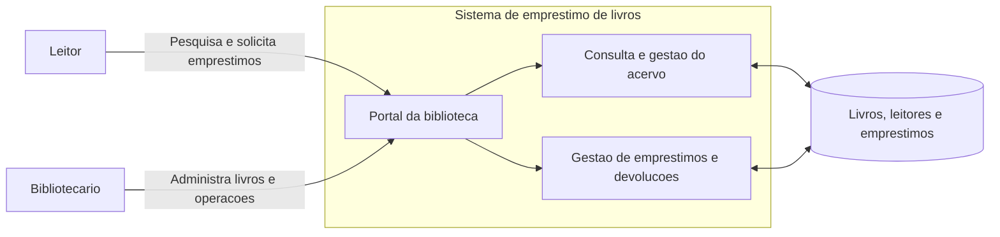
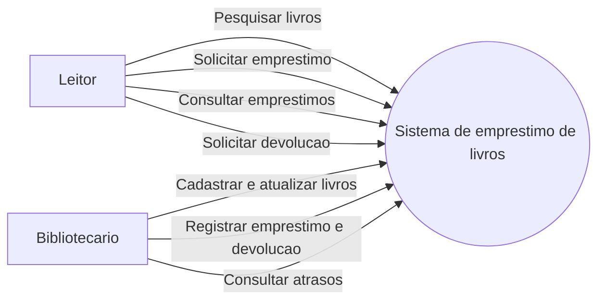
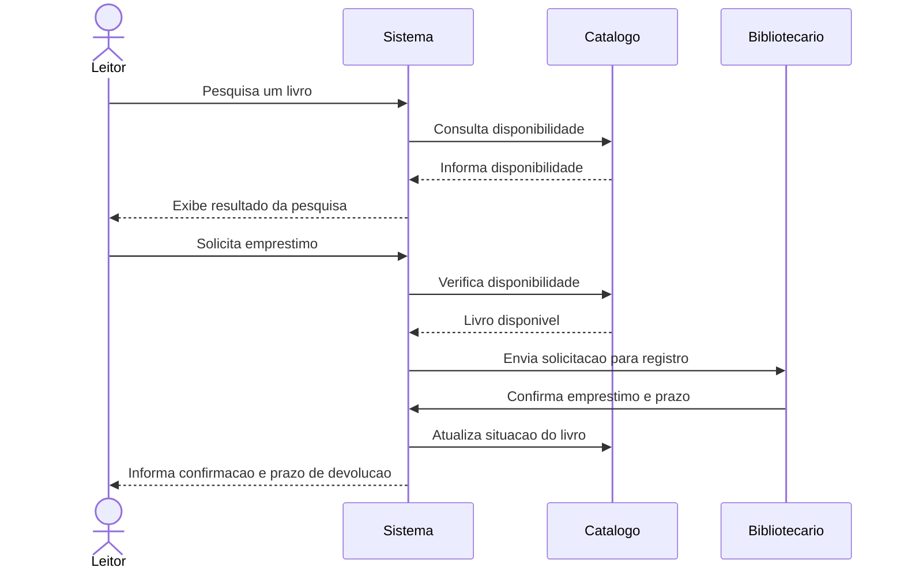
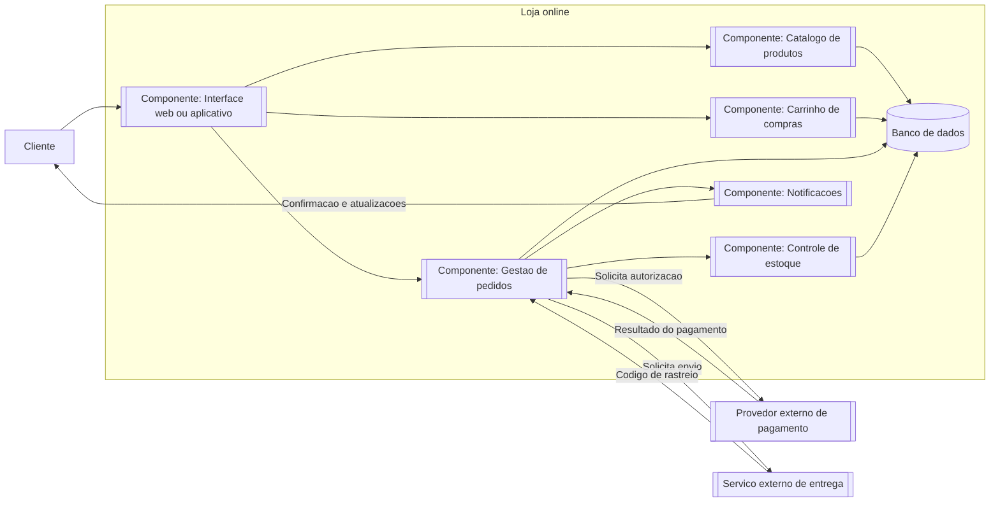
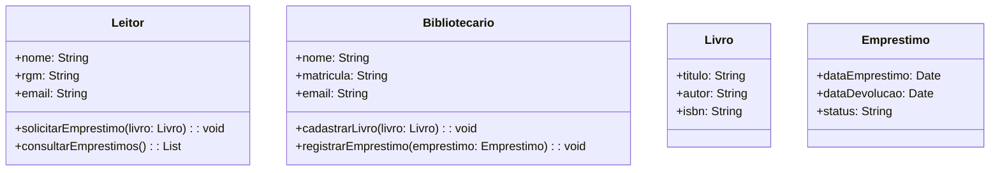

o processo unificado UP adota o desenvolvimento de software baseado em componentes, ou seja, preve que o sistema de software pode ser construído
através da composição de componentes de softwares interconectados através de interfaces bem definidas. seg pressman seguindo a UML o processo unificado define os componentes
de software qye serão usados para construir o sistema e as interfaces.
maneira mais facil de visualizar o software inteiro em formato grafico.
o UP adota desenvolvimento iterativo e incremental e define as funções do sistema aplicando uma abordagem baseada em cenários denominada modelo de casos de uso.

---

RUP é uma instancia mais especifica do UP e as melhores paticas de processos de software incorporadas nestes processos de software incorporadas neste processo são Pressman e sommervile
desenvolvimento iterativo;
gerencia de requisitos;
utilização de arquitetura e componentes;
exemplo de rup

---

qual nivel de capacidade da mais confilto, refatoração 2

---

UML define a representação gráfica que deve ser utilizada pra modelar sistemas orientados a objeto, através de grafos. Ela não define fases ou como a linguagem deve ser utilizada ao logno das fases
do processo n e metodologia, so apresenta maneiras de mostrar o seu sistema de maneiras mais intuitiva.
grafos-parte matematica + parte visual.

---

exemplo de UML:
visao geral do sistema de emprestimo de livros

O sistema permite que leitores pesquisem o acervo, consultem a disponibilidade e solicitem emprestimos. O bibliotecario administra os livros e confirma emprestimos e devolucoes. O sistema registra os prazos, atualiza a disponibilidade e permite consultar emprestimos em atraso.

### Visao geral do sistema

### Diagrama de casos de uso

### Diagrama de sequencia: solicitacao de emprestimo

### Diagrama de componentes: compras online

Neste exemplo, a loja online e dividida em componentes com responsabilidades distintas. A interface recebe as acoes do cliente e utiliza os servicos de catalogo, carrinho e pedidos. O componente de pedidos coordena o pagamento, a baixa de estoque, o envio e as notificacoes. O provedor de pagamento e o servico de entrega sao sistemas externos integrados a loja.

Fluxo principal: o cliente escolhe produtos, monta o carrinho e confirma o pedido. A loja solicita o pagamento; se aprovado, registra o pedido, atualiza o estoque, solicita a entrega e envia a confirmacao ao cliente.
quando a linha é solida, significa que o componente faz parte da loja online e interage com outros componentes internos.
quando a linha é pontilhada, significa que o componente é externo e nao faz parte da loja online, mas interage com ela. Ou seja,
a pontilhada é opcional, mas a solida é obrigatoria.

diagrama de objetos: solicitacao de emprestimo

