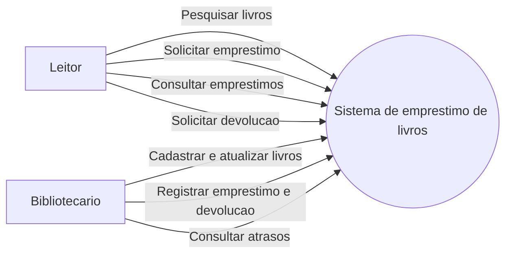
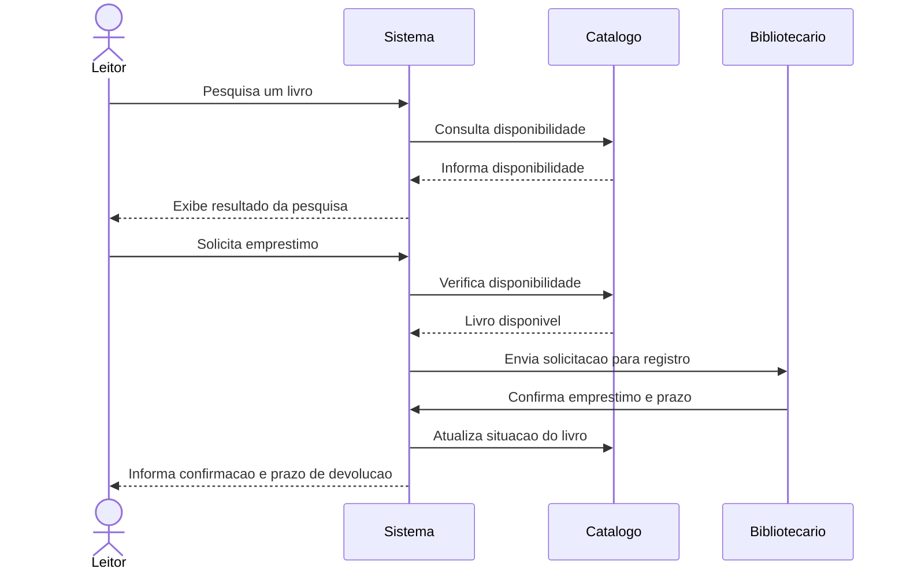

o processo unificado UP adota o desenvolvimento de software baseado em componentes, ou seja, preve que o sistema de software pode ser construído
através da composição de componentes de softwares interconectados através de interfaces bem definidas. seg pressman seguindo a UML o processo unificado define os componentes
de software qye serão usados para construir o sistema e as interfaces.
maneira mais facil de visualizar o software inteiro em formato grafico.
o UP adota desenvolvimento iterativo e incremental e define as funções do sistema aplicando uma abordagem baseada em cenários denominada modelo de casos de uso.

---

RUP é uma instancia mais especifica do UP e as melhores paticas de processos de software incorporadas nestes processos de software incorporadas neste processo são Pressman e sommervile
desenvolvimento iterativo;
gerencia de requisitos;
utilização de arquitetura e componentes;
exemplo de rup

---

qual nivel de capacidade da mais confilto, refatoração 2

---

UML define a representação gráfica que deve ser utilizada pra modelar sistemas orientados a objeto, através de grafos. Ela não define fases ou como a linguagem deve ser utilizada ao logno das fases
do processo n e metodologia, so apresenta maneiras de mostrar o seu sistema de maneiras mais intuitiva.
grafos-parte matematica + parte visual.

---

exemplo de UML:
visao geral do sistema de emprestimo de livros

### Diagrama de casos de uso

### Diagrama de sequencia: solicitacao de emprestimo

